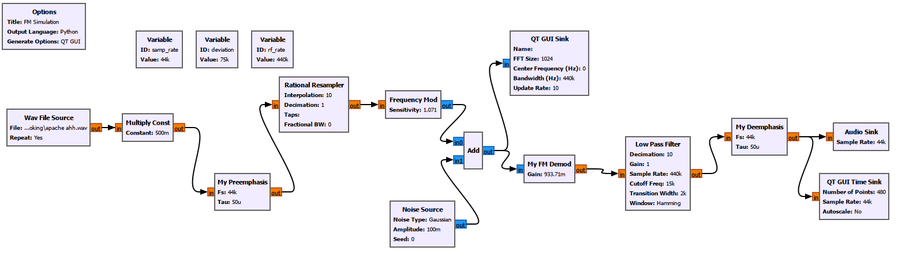
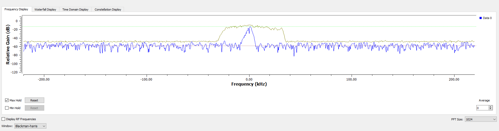
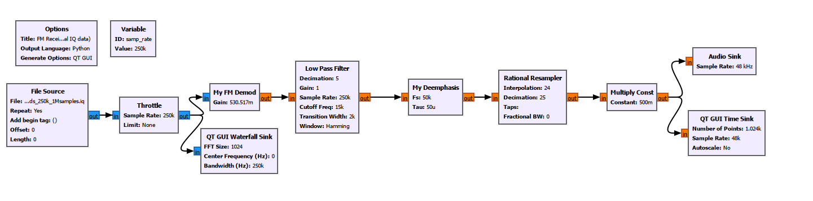
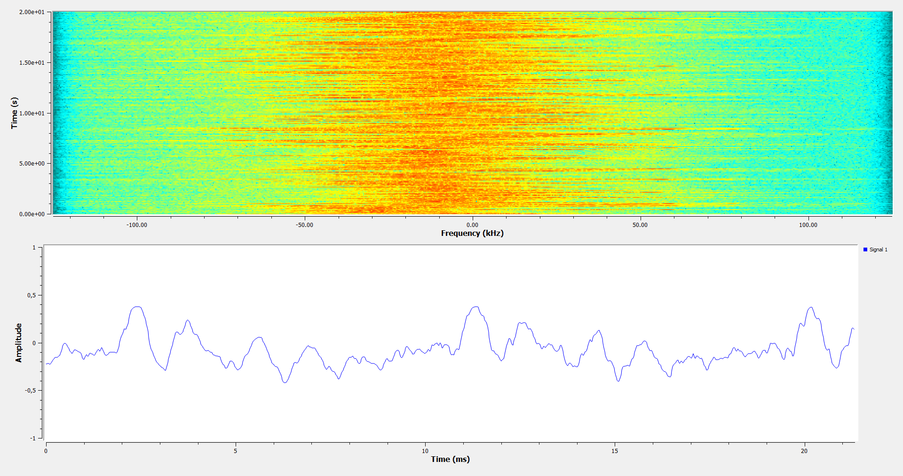

# FM Receiver in GNU Radio

Complex-baseband FM transmission chain and receiver built in GNU Radio,
with custom Python blocks for demodulation and pre-/de-emphasis.

## Contents
- `fm_sim.grc`: simulated chain (audio -> pre-emphasis -> FM modulation -> AWGN -> demodulation -> de-emphasis)
- `fm_rx_real.grc`: receiver applied to a real FM broadcast IQ recording
- `blocks/`: custom streaming blocks (Python/NumPy, SciPy)

## Demodulator
Discrete-time FM signal with frequency deviation deltaf and sample rate fs:

    x[n] = exp(j*phi[n]),  phi[n] = phi[n-1] + 2*pi*(deltaf/fs)*m[n]

The message is recovered from the phase difference of consecutive samples:

    m_hat[n] = fs / (2*pi*deltaf) * arg(x[n] * conj(x[n-1]))

This is exact as long as fs > 2*deltaf. The last sample of each buffer is kept as
state so the output is continuous across block boundaries.

## Pre-/De-emphasis
After FM demodulation the noise PSD grows with f^2, so high frequencies are boosted
before modulation and attenuated after demodulation (tau = 50 us, Europe).

    De-emphasis: y[n] = alpha*x[n] + (1-alpha)*y[n-1],  alpha = 1 - exp(-1/(fs*tau))

Pre-emphasis is its exact inverse, so the audio path is transparent without noise.
The filter state is likewise kept across buffers.

## Real-world test
IQ recording: 250 kHz, complex64, centered on an FM station
(from [PySDR](https://pysdr.org/content/rds.html),
[download](https://github.com/777arc/498x/blob/master/fm_rds_250k_1Msamples.iq?raw=true)).

Chain: 250 kHz -> demod -> LPF (decimation 5) -> de-emphasis (50 kHz) -> resample 24/25 -> 48 kHz audio.

To run the flowgraphs, set the file paths in the *Wav File Source* (`fm_sim.grc`)
and *File Source* (`fm_rx_real.grc`) blocks to your local files.

## Results

### Simulation

*Max-hold spectrum (yellow) with music input at fs = 440 kHz. The envelope extends
to about +/-33 kHz, which for wideband FM approximately equals the peak instantaneous
frequency deviation. It stays well below the 75 kHz maximum because the audio is
scaled by 0.5 and rarely reaches full scale. The flat floor at about -50 dB is the
added AWGN.*

### Real IQ data

*Top: waterfall of the recorded broadcast at fs = 250 kHz. The station is centered
at 0 Hz and occupies roughly +/-60 kHz, wider than the simulated signal because the
broadcast multiplex also carries the 19 kHz pilot, the L-R stereo subcarrier at 38 kHz
and RDS at 57 kHz. The darker edges are the SDR's anti-aliasing filter.
Bottom: demodulated audio at 48 kHz from the custom demodulator. The 15 kHz
low-pass keeps only the mono (L+R) part.*
